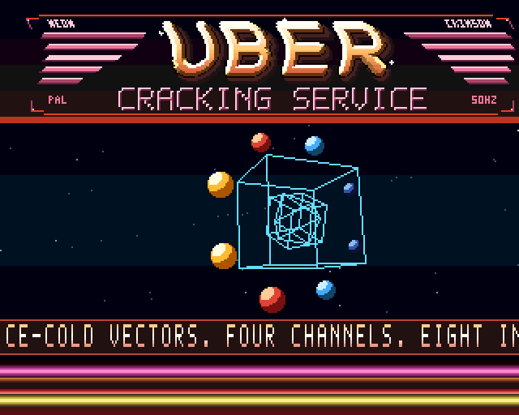

# Neon Vectors Crimson

A source-complete PAL Amiga demo: three nested wireframes, a perspective starfield,
eight orbiting sprite balls, a layered, rippling metal logo and a scrolling message over a
glowing red, orange and pink Copper-bar floor. The visual identity pairs gold and
copper lettering with ice-cyan vectors, crimson framing and native-pixel machine labels. A generated four-channel tracker tune plays
through Paula. Press the **left mouse button** to return to the system.

Crimson is a variant of Uber Cracking Service’s *Neon Vectors*. The implementation
uses Motorola 68000 assembly and OCS/ECS display hardware. It also runs on compatible
AGA machines; the experimental AGA tools are not part of the executable.



The image comes from the program’s Copper list and bitplane memory in the host test
harness, including its model of the eight ball sprites. Sprite buffers and pointers
are also checked against independent ring calculations.

## Build

You need Python 3.8+, Make and `vasmm68k_mot` (VASM’s Motorola syntax assembler).
Asset generation uses only the Python standard library.

```sh
make toolchain       # optional: build a local VASM if none is installed
make -j4             # validate, assemble, check the Hunk executable
```

The executable is `build/neon_vectors`. Supply `VASM=/absolute/path/vasmm68k_mot`
if your assembler is elsewhere. `make toolchain` fetches upstream source over HTTPS;
if that server is unavailable, unpack a trusted VASM source tree and use
`VASM_SRC=/absolute/path/to/vasm make toolchain`. The bootstrap never replaces a
caller-supplied directory.

Run from an Amiga Shell with a PAL 68000/OCS or ECS configuration and sufficient free
chip RAM (512 KiB machine configuration or more). Genuine Kickstart and physical
hardware compatibility still require release testing. A500-class timing is the
intended target; the host CPU model omits DMA contention and blitter timing.

## What plays

The display is 320×256, four bitplanes and 16 indexed colours, with Copper palette
changes by band and scanline. Six screen-sized buffers provide double buffering for
the two object planes. They do **not** make this a six-bitplane AGA display.

Eight sections run for 256 frames each, looping after 2,048 frames (40.96 seconds at
50 Hz). They change star speed, rotation rate, object sizes and visibility:

| Section | Scene |
| --- | --- |
| 0 | Outer cube, octahedron and inner cube |
| 1 | Outer cube alone |
| 2 | Fast stars and enlarged inner cube |
| 3 | Enlarged octahedron at double spin |
| 4 | All three with faster stars |
| 5 | Octahedron and enlarged inner cube |
| 6 | Fastest stars and outer cube |
| 7 | Three-object finale at double spin |

The 64 stars use perspective and three depth brightnesses. The wireframes have 22
projected vertices and up to 36 blitter-drawn edges. Eight shaded hardware sprites
orbit on a depth-sorted ring. The 16-line text strip advances one pixel every two
frames; the logo has independent horizontal scroll on each of its 64 rows.

Music uses eight generated instruments: saw bass, pulse lead, pad, kick, snare,
closed hat, open hat and chime. Six patterns form an eight-position arrangement. Samples
are signed 8-bit PCM with zero-valued silence. This is a deliberately bounded MOD
player, not a general ProTracker implementation; see [music](docs/MUSIC.md).

## Check changes

```sh
make test            # malformed-Hunk and experimental-helper regression tests
make validate        # asset contracts and static 68000 source checks
make verify-repro    # deterministic generation AND checked-in asset freshness
make mutants         # deliberate source faults must be rejected
make emutest         # requires: python3 -m pip install machine68k
make emu-mutants     # slower behavioural mutation tests
make release         # verify manifest, build, regressions, mutations and reproducibility
```

For the full visual section cycle and song wrap:

```sh
python3 tools/emu_test.py --frames 3200 --snap 1850
python3 tools/emu_test.py --loader-chip
python3 tools/emu_test.py --open-fail               # graphics.library unavailable
python3 tools/emu_test.py --alloc-fail              # AllocMem returns NULL
python3 tools/emu_test.py --alloc-fast
python3 tools/emu_test.py --ntsc --frames 100
```

The behavioural harness executes assembled machine code, checks system restoration,
DMA setup, audio triggers and reloads, and compares pixels against independent
references. Its timing excludes DMA bus stealing. It cannot establish how the
music sounds, emulate Kickstart, or replace cycle-exact and physical-machine tests.
An NTSC run checks escape from the PAL wait loop, not correct NTSC presentation.

## Change the demo

Edit `scroll_text` and `sec_tab` in `src/main.s` for the message and scene sequencing.
Keep scene geometry within the 120-line middle band and update the independent
scene expectations in `tools/emu_test.py` when deliberately changing choreography.
Palette and table generators live in `tools/gen_tables.py`; those assembly tables
are embedded in the source, so inspect and paste regenerated tables explicitly.

Edit `tools/generate_assets.py` for instruments, patterns or the font, and
`tools/logo_art.py` for logo geometry. Run `make assets` to regenerate the committed
assets, then `make verify-repro`. An alternate output directory is supported:
`python3 tools/generate_assets.py --output /tmp/neon-assets`.

The player accepts sample-and-period notes, sample default volumes, `Cxx` volume,
and `F01..F1F` speed. Unsupported effects, finetune, period-only notes and notes
using empty samples are rejected during validation.

## Code and documentation

- [Architecture and ownership](docs/ARCHITECTURE.md)
- [Art direction and colour roles](docs/ART_DIRECTION.md)
- [Graphics and scene data](docs/GFX.md)
- [Music and Paula](docs/MUSIC.md)
- [Build and acceptance checks](docs/BUILD_AND_TEST.md)
- [Validation contract](docs/VALIDATION.md)
- [Audit findings](docs/AUDIT.md)
- [Experimental AGA status](README_AGA.md)
- [Release history](RELEASE_NOTES.md)

## Distribution candidate

After reviewing changes, run `make manifest`, commit them, and run `make dist`.
Distribution requires `machine68k`: the gate executes a full 3,200-frame music/scene
loop, the chip-loader scenario and NTSC escape check before packaging.
Release checks fail on a stale manifest rather than rewriting it. Packaging requires
a clean committed checkout and produces `build/neon_vectors_crimson.zip` with the
executable, Amiga Shell instructions, full source revision and payload checksums.
Fixed ZIP metadata makes repeated packaging of the same inputs byte-identical.
The executable entry has executable permissions; no ROMs or toolchain are included.

`make dist` is a packaging gate, not physical-machine certification. Complete the
hardware and listening acceptance checks before publishing a final hardware release.
