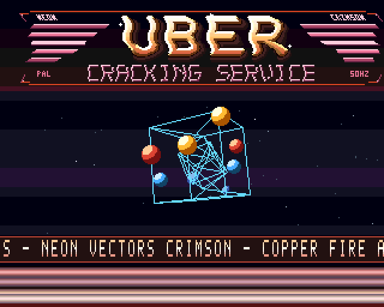

# Graphics

The PAL display is 320×256, four bitplanes and 16 indexed colours. Copper moves
change palette values by band and scanline. The bitmap and sprite payloads live
in verified chip RAM.

## Layout

| Rows | Content |
| --- | --- |
| 8–71 | Procedural bevelled UBER / CRACKING SERVICE logo |
| 72–75 | Animated colour slot |
| 76–195 | Stars, wireframes and orbiting sprite balls |
| 200–215 | Double-height text scroller |
| 222–255 | Crimson Copper-bar floor |

Display line equals row + 44. A `WAIT $FFDF,$FFFE` permits Copper waits after
line 255. Floor colours are red, orange, amber and pink, with near-white bar cores and a dark ember floor. The animated band below the
logo uses a scene-coloured separator glow with a 128-frame base cycle. Actual
kick, snare and chime cues lift it through four brightness levels; its restrained
peak avoids the old independent white flash.

## Buffer ownership

Six physical screen buffers hold plane 0, plane 1 front/back, plane 2, and plane 3
front/back. Only **four** planes are displayed. Plane 0 carries middle stars and
text, plane 2 carries far stars; near stars combine them. The logo uses all four
planes. Object plane 1 is double-buffered; plane 3 has matching front/back storage.
Palette indices overlapping wireframes retain their wireframe colour.

The display fetches 21 words per line from two bytes before each plane, with
modulo −2. The extra fetch word permits per-row `BPLCON1` scroll and is hidden by
the display window. A spare word precedes the first bitmap. `PatchCopper` updates
data words at offsets 2/6, 10/14, 18/22 and 26/30 from the plane-pointer list.

## Effects

The logo is 320×64, generated from distance-field strokes, arcs, bevel shading,
a shadow and subtitle geometry in `tools/logo_art.py`. The subtitle uses warm rose/copper tones. Each row’s horizontal
scroll is indexed by `(4*frame + 3*row) & 255`, using eight scene-specific harmonic profiles and scroll reset below the logo.

The 64 stars retain their last offset, mask and brightness class. Every old pixel
is erased before any new pixel is drawn, avoiding collisions that erase another
star. Scene-dependent depth speed wraps stars to new deterministic lanes. The
hot path caches speed, looks up row byte offsets and forms MSB-first pixel masks
without a multiply or reversed bit count.

The outer cube, octahedron and inner cube provide 22 projected vertices and 36
possible edges. Three 7-bit fixed-point rotation matrices transform their sign
coordinates at the scene-selected magnitudes. The centre sways and the depth
breathes; a reciprocal table projects into the middle band. `sec_tab` selects
which sets of 12 edges are drawn. All eight scenes loop after 2,048 frames.

A D-only blit clears the hidden object band before line blits draw it. The next
frame displays that buffer. Line-mode octants follow the hardware reference table;
`ONEDOT` remains clear for solid shallow lines. Current scene geometry stays within
the band; adding larger objects requires clipping or renewed bounds validation.

Eight hardware balls follow eight scene-specific closed curves, with tilt and roll. The program sorts them by
depth, selects one of three prebuilt sizes and patches the corresponding sprite
pointers. Far sprite channels are placed behind the playfield using `BPLCON2=$0010`.
In single-playfield mode, PF2P (bits 5–3) controls that priority, not PF1P. See
the [hardware priority reference](https://amigadev.elowar.com/read/ADCD_2.1/Hardware_Manual_guide/node0159.html).

The scroller shifts big-endian longwords from right to left using `ROXL`. X is
cleared at the start of each row. Each glyph row is repeated vertically, and a new
column is inserted every second frame.

## Verification limits

The machine-code harness models line blits and Copper display fetch, compares the
wireframe bitmap every frame, and compares stars, scroller, logo scroll, palette
and floor at a selected snapshot. It also checks sprite data and pointers separately.
It composites the ball sprites, but does not model DMA contention or blitter duration. Use a
cycle-exact emulator and real hardware for final visual and timing acceptance.

The wave routine advances a wrapped byte index directly, eliminating redundant
per-row phase arithmetic. Floor-bar top positions are precomputed using the same
fixed-point formula as before, removing four per-frame multiplications without
changing their paths. Both tables are generated by `tools/gen_tables.py`.

## Classic Amiga art direction

The screen uses three deliberate accents: gold/copper identity, ice-cyan geometry,
and crimson framing. Lower-saturation stars and a darker midnight field preserve
contrast. The scroller uses a cream-to-gold Copper ramp over an oxblood strip, and
the warm sprite pair is ruby/red rather than pink.

The procedural logo includes chamfered pixel corner brackets and hand-defined 3x5
NEON, CRIMSON, PAL and 50HZ lettering. These details are part of the four-plane bitmap,
not host-rendered overlays. The original UBER / CRACKING SERVICE identity remains.
The scroller reads like a scene greeting and credits the 68000/Copper/Paula machine
itself, without invented historical dates or additional authorship claims.

## Musical choreography

`MOD_Row` identifies kick, snare and chime onsets and starts `visual_pulse` at 15.
`UpdateSection` decays the envelope each frame, selects a scene-specific ring tilt,
and retains the existing object/star settings. `UpdateBars` indexes the scene’s
four precomputed light banks. Runtime arithmetic selects a bank; colour blending
happens entirely in the host generator. The original motion paths and Copper list
length remain intact. See [the captured scene gallery](SCENES.md).

The middle-band background now uses a moving Copper interference curtain. The
fifteen existing COLOR00 slots receive scene-specific precomputed colours at
half frame speed. No additional Copper moves or bitplane fetches are required.

## Music-triggered energy bridges

When both cubes are visible, the kick/snare/chime envelope selects two, four,
six or eight connecting lines between corresponding outer and inner cube vertices.
The order adds opposing pairs of cube corners, keeping the decay balanced.
Envelope levels 1–4 select one pair, 5–8 two, 9–12 three and 13–15 all four;
zero removes the links.
Their independent rotations continuously reshape the resulting cage. The links
are drawn into the same hidden wireframe buffer as the objects, so they inherit
its tear-free swap and disappear on the next buffer clear after the envelope falls.
The full-ensemble scenes can now draw 44 edges; the other scenes keep their
existing object selection. The projected endpoint bounds also bound every link.

## Eased sprite scene joins

For the first 32 frames of every movement, including the loop back to Ignition,
world-space sprite paths blend from the previous scene with a smoothstep curve.
The base tilt follows the same easing; ongoing spin, roll and tilt wobble continue.
Precomputed eight-ball positions avoid per-ball multiplies for the blend. At the
last transition frame the table equals the destination path exactly. Three depth
sizes, stable sorting and normal projection remain active throughout.
