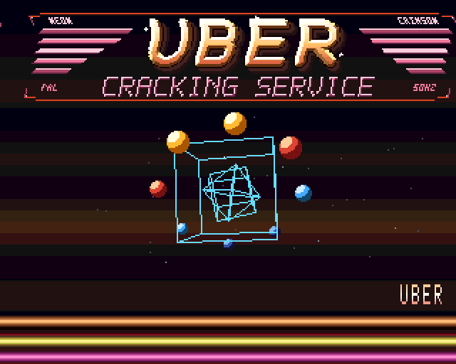
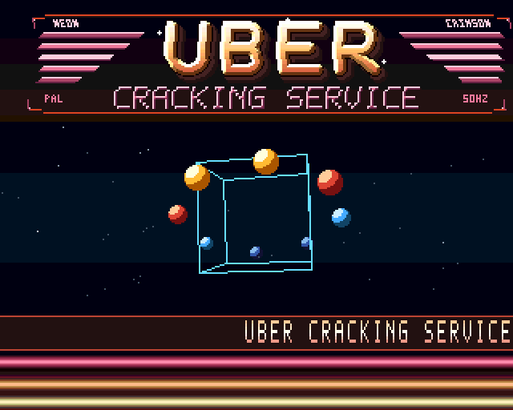
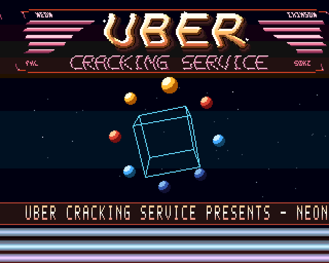
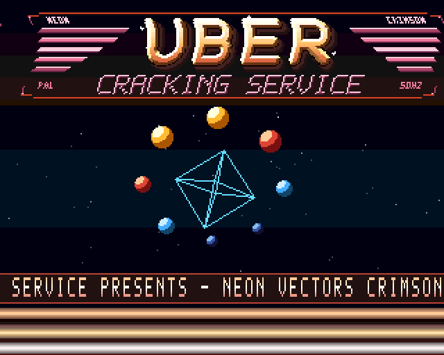
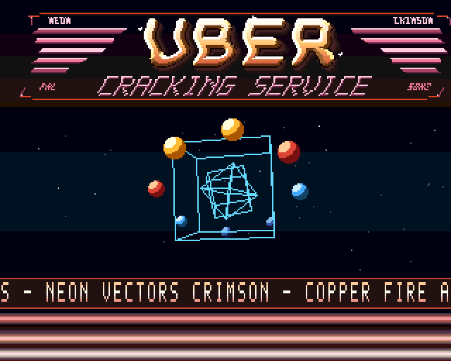
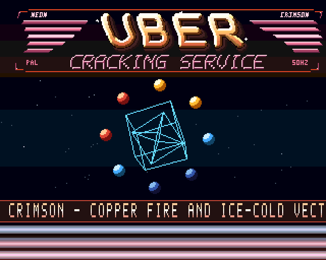
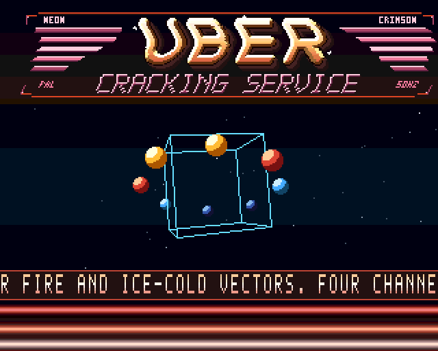
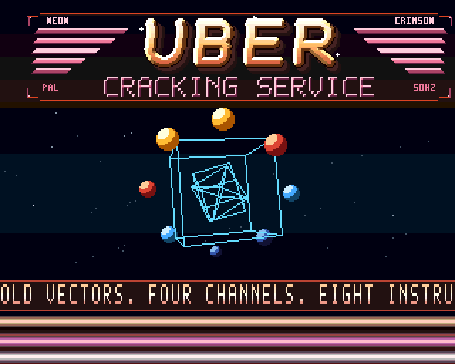

# Eight movements of Crimson

These frames are captured from the assembled executable on the emulated 68000.
Each movement lasts 256 frames; all eight loop in about 41 seconds. Their names
identify the choreography, floor colours, logo motion and sprite-ring attitudes.

| Ignition | Prism |
| --- | --- |
|  |  |
| Crimson opening with three objects. | Ruby and amber, cube alone, flatter orbit. |

| Phase Shift | Diamond |
| --- | --- |
|  |  |
| Ice/violet warp and an enlarged inner cube. | A large octahedron turning through copper and gold. |

| Constellation | Orbital |
| --- | --- |
|  |  |
| Three objects against warm dusk colours. | Blue/ruby counterpoint and a steeper sprite orbit. |

| Redline | Afterglow |
| --- | --- |
|  |  |
| Fastest stars, hot red/white bars, outer cube. | Three-object finale with gold and ruby light. |

## Music becomes light

The replay routine recognizes actual kick, snare and chime note triggers. Each
starts a 15-frame envelope; the following visual updates select one of four
brightness banks. A stronger musical passage produces more flashes naturally.
The original four-channel tune and tick timing stay intact.

The 40.96-second visual cycle and 61.44-second song have different lengths, so the
same movement meets different musical phrases on repeat. Their schedules realign
after 122.88 seconds at nominal 50 Hz: three visual cycles against two song loops. The starfield and
scrolling message continue independently.

Eight scene palettes × four light levels × 32 Copper colours occupy 2 KiB of
ordinary data RAM. The bitplane count, chip-RAM allocation and per-row Copper
instruction count stay unchanged. Sprite-ring tilt changes at scene boundaries.

Regenerate the captures with `make gallery`. For a full song-loop test and capture:

```sh
python3 tools/emu_test.py --frames 3200 --snap 1850 --gallery-dir build/scene-gallery
```

For the complete schedule alignment, use `--frames 6400 --snap 4490`.

The harness checks the music envelope and eight sprite buffers every frame, the
wireframe bitmap every frame, and the floor lighting at each gallery capture.
Its hardware model still omits DMA contention and blitter duration.

## Eight logo motions

The Copper scroll now follows a different harmonic profile in every movement:
layered ignition, a restrained prism shimmer, a triple-frequency phase shift,
a broad diamond swell, a fine constellation ripple, an opposing orbital wave,
a sharp redline interference pattern and a quiet afterglow. Each profile loops
continuously and stays within the safe 2–14 pixel fetch range.

The eight 256-word tables occupy 4 KiB of ordinary data, replacing the previous
512-byte table. Scene selection happens once per frame; the 64 Copper row writes,
chip allocation and display planes are unchanged. The emulator checks every row
on every frame, including scene transitions and wraparound.
